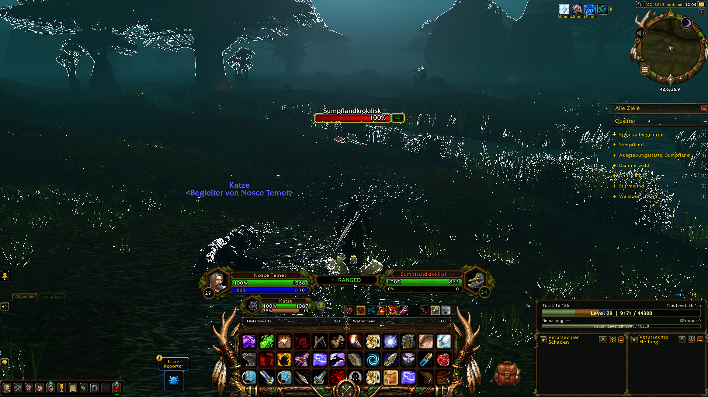
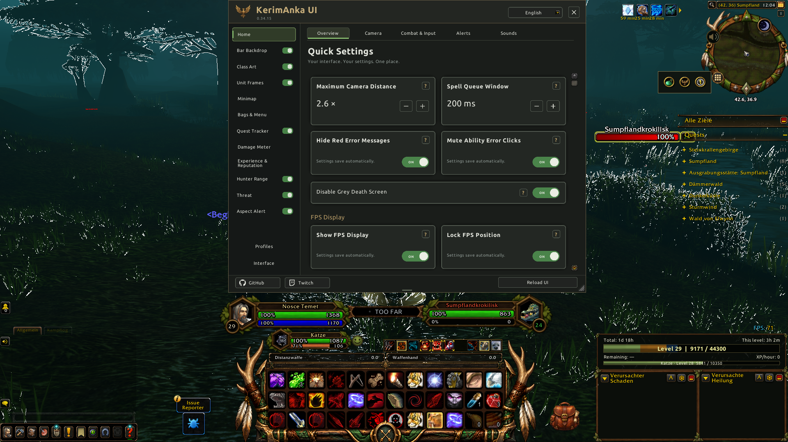

# KerimAnka UI

A modular interface suite for World of Warcraft: Forever, with class-themed artwork,
ready layouts for all nine classes, and a shared settings panel in nine languages.

[Downloads](https://github.com/kerimanka-ui/KerimAnkaUI/releases) ·
[Report a bug or suggest a feature](https://github.com/kerimanka-ui/KerimAnkaUI/issues) ·
[Twitch](https://www.twitch.tv/kerimanka) ·
[Changelog](CHANGELOG.md)

Current version: **0.34.16**. Download the complete-suite ZIP from Releases;
the first downloadable release is being prepared.

KerimAnka UI brings class artwork, action-button backgrounds, unit frames,
minimap presentation, quest tracking, experience and reputation displays,
threat, sound controls, and profile management into one settings panel.

## Screenshots

### Hunter ready layout

### Shared settings panel

[Class Art settings](docs/screenshots/hunter-class-art.png) ·
[Unit Frames preview and settings](docs/screenshots/hunter-unit-frames.png)

These are original in-game captures. The world is shown at night, and native
game text follows the player’s German client language.

## Compatibility

This project targets the World of Warcraft: Forever client (Interface 16001).
The ready layouts were tuned for 1920 x 1080. Other resolutions and UI scales
may need positioning adjustments. Retail and Classic Era compatibility is not claimed.

## Main features

- Ready layouts for all nine classes, with confirmation before applying a layout.
- Class-themed action bar artwork, minimap presentation and unit frames.
- Supported Blizzard action bars or optional Bartender4 integration.
- Character snapshots, named profiles and import/export.
- Transfer of captured Blizzard Edit Mode and Bartender layouts when available.
- Quest tracking, target threat, experience and reputation displays.
- Sound controls, ready mute groups and custom sound FileDataID entries.
- Hunter range and aspect reminders.
- English, German, Turkish, Simplified Chinese, French, Italian, Spanish,
  Brazilian Portuguese and Russian panel languages.

## Download and installation

Official download packages will be listed on the
[GitHub Releases page](https://github.com/kerimanka-ui/KerimAnkaUI/releases).
No downloadable release has been published yet. A CurseForge link will be added
once the project has an approved page there.
Prefer the explicitly attached complete-suite ZIP to GitHub's automatic
source-code archives. A source archive contains this repository inside an extra
folder; that containing folder does not belong in Interface/AddOns.

Extract the nine KerimAnkaUI folders directly into the game client's
Interface/AddOns directory. Open the panel with `/kaui`, `/kerimanka`, or the
minimap icon. Follow the first-use guide to Profiles if you want to apply a ready
layout. For updates to an existing installation, replace the addon files and
use `/reload`. Preserve your WTF folder and SavedVariables.

For details, see [the included user guide](KerimAnkaUI/README.md).

## Optional addons

Bartender4 and Questie are optional. Details! is required only for the optional
Details skin module; it is not bundled. Other third-party addons are not included.

## Contact and feedback

Use [GitHub Issues](https://github.com/kerimanka-ui/KerimAnkaUI/issues) to report
a reproducible bug or suggest a feature. Issues and their replies are public
once the repository is public; do not post private information there. Include your addon version, client build, class, action-bar provider,
steps to reproduce, and any Lua error. English reports are welcome.
Review screenshots before posting and do not upload credentials or your entire
WTF folder. The [contribution guide](CONTRIBUTING.md) explains what to include.

Twitch: [KerimAnka](https://www.twitch.tv/kerimanka). Streams are in Turkish;
GitHub Issues is the preferred channel for technical reports.

For private inquiries, email
[kerimanka.twitch@gmail.com](mailto:kerimanka.twitch@gmail.com).
GitHub does not provide a general private messaging inbox.

Version changes are recorded in [CHANGELOG.md](CHANGELOG.md). Each published
release will also include release notes and an installable complete-suite ZIP.

## Optional support

KerimAnka UI is free to use. If you would like to support its development, you
can [buy me a coffee](https://buymeacoffee.com/kerimcandan).
Support is entirely optional and does not unlock addon features or priority
support. The external payment page may display the creator's public name.

## Third-party notices

The Ubuntu fonts and LibSerialize retain their included license notices.
Third-party licenses do not apply to all project code or artwork.

## License

KerimAnka UI is free to use under the [KerimAnka UI Limited Use License 1.0](LICENSE).
You may inspect the code and make changes for your own private use. Normal
gameplay streams, videos and screenshots, including monetized content, are allowed.
Redistribution, publication of modified versions, and reuse of project-owned code
or original artwork in another project require prior written permission. This
includes free redistribution and paid bundles. Platform rights and third-party
licenses remain unaffected. This is not an open-source license.
See LICENSE for the full terms and CONTRIBUTING.md before submitting changes.
